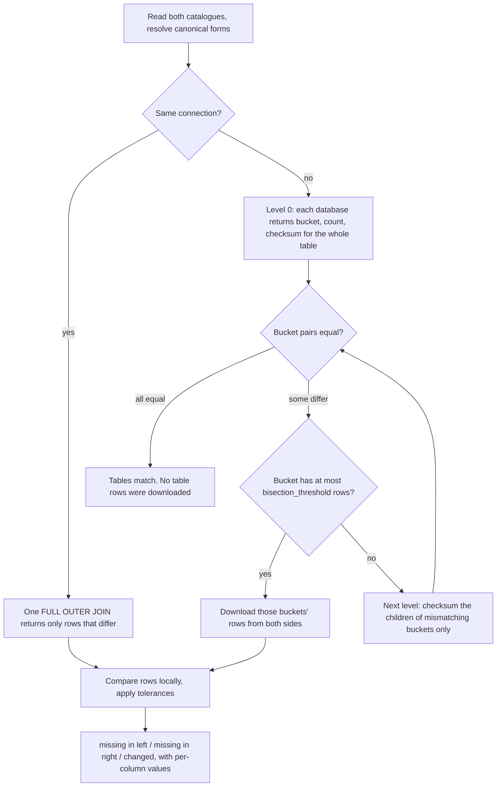

# How the diff works

This document describes what reconkit sends to each database and why. The code is in
`src/reconkit/diff/` and is small enough to read alongside this page.

## The problem being solved

Two tables live in two databases. Pulling both to one place and comparing them costs
network transfer and client memory proportional to the table size, every time, even when
the tables are identical. reconkit instead asks each database to summarise its own rows
and only downloads the rows where the summaries disagree.

## Step 1: one canonical text form per column

A checksum computed in Postgres can only be compared with one computed in Snowflake if
both engines hash exactly the same bytes for the same logical value. So before anything is
hashed, every compared column is rendered to a canonical text form. reconkit reads both
tables' column types from the catalogue, picks one canonical form per column pair
(`resolve.py`), and each dialect emits SQL that produces it (`adapters/`):

| Column pair | Canonical form | Notes |
| --- | --- | --- |
| integer / integer | decimal digits, e.g. `-42` | |
| boolean / boolean | `true` / `false` | |
| boolean / integer | `1` / `0` | common when a warehouse stores flags as integers |
| any mix of integer, decimal, float | fixed-scale decimal, e.g. `10.50` | scale is the smaller of the two sides' scales; floats and unconstrained numerics count as `float_precision` (default 6); override per column with `precision` |
| date / date | `YYYY-MM-DD` | |
| timestamp / timestamp | `YYYY-MM-DD HH:MM:SS.ffffff` in UTC | fractional digits beyond `timestamp_precision` are truncated, not rounded |
| date / timestamp | timestamp form; the date is midnight | `naive_timezone` is not applied to this pair |
| uuid / uuid or text | lower-case text | |
| text / text | the text | optional `trim_whitespace` (trailing only) and `empty_string_as_null` |
| anything else | each engine's own text cast | a warning is added to the result; do not rely on it |

Timestamps deserve a paragraph because they cause most false differences in practice.
A timezone-aware column (`timestamptz`, `TIMESTAMP_TZ`, BigQuery `TIMESTAMP`) is converted
to UTC explicitly, so the session time zone of either connection does not matter. A
timezone-naive column is taken at face value, unless the table side is configured with
`naive_timezone: Asia/Singapore` (for example), in which case naive values are interpreted
as wall-clock time in that zone and converted to UTC. That one setting is the difference
between "every row differs by eight hours" and a clean reconciliation.

NULL is encoded separately from every value: a column contributes `N` when NULL and
`V` followed by its canonical text otherwise. A NULL can therefore never collide with an
empty string or with the literal text `N`.

## Step 2: a row hash and an additive checksum

The encoded columns (key columns first) are joined with `|` and hashed with MD5. The last
15 hex digits, 60 bits, are kept as a non-negative integer, which fits a signed 64-bit
integer on every engine. The checksum of a set of rows is the **sum** of their row hashes
together with the **row count**.

Why these choices:

- **MD5** is the one hash function with identical output available in all five engines
  without extensions. It is used as a fingerprint, not for security.
- **Sum** is the one aggregate over 60-bit integers that all five engines compute without
  overflow (as `numeric`/`HUGEINT`/`NUMBER(38)`), and it is order-independent, so the
  database can scan in any order and in parallel. XOR would do as well but has no portable
  aggregate.
- **Key columns are part of the row hash.** Otherwise two rows with different keys and
  the same payload, one missing on each side, would cancel out.

A mismatch is missed only if the sums of 60-bit hashes collide while the counts are equal.
For random hashes that is a probability on the order of 2^-60 per compared bucket.
One structural case is worth knowing: because columns are joined with a separator rather
than length-prefixed, a row where text moved across a column boundary (`('a|b', 'c')`
against `('a', 'b|c')`) hashes the same. Only adjacent text columns that contain the `|`
character can do this.

## Step 3: bucket, compare, split



Each level is **one aggregate query per side** (`GROUP BY bucket`), restricted to the
buckets that mismatched at the previous level. The two sides are queried concurrently.
The number of queries therefore grows with the depth of the recursion, not with the
number of differences: if a thousand buckets mismatch, they are refined by one statement
per side, not a thousand. (Lists longer than `max_buckets_per_query`, 256 key ranges by default,
are split across statements to keep the SQL text bounded. Hash bucketing packs 64 times
as many buckets into a statement, since each of its statements is a full scan.)

### Range bucketing (integer first key column)

The key range `[min, max]` across both sides is cut into equal-width buckets whose widths
are `c * factor^m, c * factor^(m-1), ..., c, 1`, so every bucket splits exactly into
`factor` children. Predicates are plain ranges on the raw key column:

```sql
SELECT (rk - 1) / 1024 AS b, COUNT(*) AS n, SUM(h) AS s
FROM (SELECT CAST(id AS BIGINT) AS rk, <row hash> AS h
      FROM loans WHERE (id >= 40961 AND id < 73729) OR (id >= 901121 AND id < 933889)) t
GROUP BY 1
```

The database can answer levels after the first from the primary-key index, reading only
the mismatching ranges. With a composite key, bucketing uses the first column and the
local comparison uses the whole key.

Equal-width buckets are uneven when keys are clustered. That costs extra levels in dense
areas (dense buckets keep splitting) but not correctness.

### Hash bucketing (uuid, text, or any non-integer first key column)

There is no arithmetic on a uuid, so rows are bucketed by `hash(key) mod M`, and the
modulus grows by `factor` per level: a row in bucket `b` at modulus `M` lands in one of
the `factor` buckets congruent to `b` at modulus `M * factor`.

The trade-off is real and worth stating plainly: no index is ordered by the hash, so
**every level is a full scan** on each side. For that reason hash bucketing sizes its
first pass so that buckets are already at the download threshold, and normally finishes
in three scans per side: a row count, the checksum pass, and the fetch of mismatching
buckets.

### Sizing the first pass

The first pass scans the whole table whatever the number of buckets, so finer buckets
are nearly free: each costs one result row of three integers, and each saves work later.
`initial_buckets` therefore defaults to automatic, sized from the row count so that a
mismatching level-0 bucket is already small enough to download:

- range bucketing: bucket width chosen so a bucket holds about `bisection_threshold`
  rows at the table's average key density, up to 65,536 buckets. Larger tables (more than
  about four million rows at the default threshold) hit that cap, and mismatching buckets
  are split once more, reading only their own key ranges;
- hash bucketing: about half of `bisection_threshold` rows per bucket (hash buckets vary
  in size, and one that exceeds the threshold costs another full scan), up to 262,144
  buckets.

In the common case a diff is therefore one checksum pass plus one fetch of the
mismatching buckets. The benchmark's parameter sweep in the README shows why this
matters: with a coarse first pass of 32 buckets, a thousand scattered
differences touch every level-0 bucket and the whole table is checksummed a second time.

## Step 4: the local comparison is the authority

Checksums only decide which rows are downloaded. Whether a row is reported is decided by
comparing canonical values locally (`compare.py`):

- canonical text equal: equal;
- otherwise, if the column has a tolerance: numbers are compared as `Decimal` against
  `abs` and/or `rel` (relative to the larger magnitude), timestamps against `seconds`;
- otherwise: different, and the column's left and right values are reported.

Rows whose checksums differed but which pass after tolerance are counted as
`within_tolerance` and not reported.

A consequence to be aware of: a tolerance does not make checksums equal. If a large share
of rows differ within tolerance (say a float column that never matches beyond five
decimals), those rows will all be downloaded. Lower that column's `precision` so the
canonical forms agree, and keep the tolerance for the stragglers.

## The same-connection fast path

When both tables are reached through the same connection, there is nothing to gain from
bisection: the database can join them. reconkit issues one `FULL OUTER JOIN` on the
encoded key, filtered to rows that are missing on one side or differ in at least one
canonical column, and runs the same local comparison on the result. Force bisection with
`strategy: bisect` if a join of the two tables is too expensive for that database.

## Sampling

`sample: 0.01` restricts both sides to keys whose hash falls in a fixed 1% slice. The
slice depends only on the key, so both sides select the same keys and the result is a
true diff of that subset: differences are found with probability equal to the sample
rate, and nothing is reported that is not a real difference. A sampled match is not a
match; the report says when a result was sampled.

## Consistency

reconkit does not take snapshots. If either table changes while a diff runs, rows written
between two levels can appear as differences (or hide in a bucket that was already
compared). Reconcile against a quiesced window: use `where` to restrict both sides to
rows older than the replication lag, for example `updated_at < now() - interval '1 hour'`.
